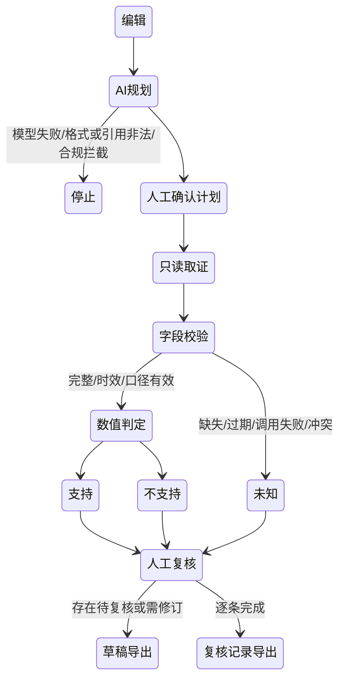

# 产品设计与价值验证

## 一个明确的场景

**目标用户**：每天撰写/复核 A 股盘后点评、内部晨会材料的研究员与复核人。

**触发**：观点已写出，但在传播前需要回答“这里每一句有什么证据？”例如“近5日跑赢基准、末日成交额放大、PE低于25倍，可能由政策催化”。

**当前替代流程**：复制观点 → 找证券和基准 → 选日期、复权、指标 → 手工计算 → 翻财务/新闻 → 记录出处 → 找复核人。数据终端、搜索与人工可以完成，但句子与字段映射、口径对齐和证据留存分散。

**值得解决的理由**：研究内容错误既可能是数值错误，也可能是时间窗口、单位、复权和因果越界。单纯生成更流畅的文字会放大错误。核验与留痕比自动给交易答案更适合当前模型能力与合规边界。

以上为产品假设及工作流分析；尚未通过真实访谈确认频次与愿付费意愿。

## 任务完成标准

一段 1–5 主张文本最终有逐条原文、类型、判定、证据字段、来源、时点、单位、统计口径、人工复核和可导出记录。任何不满足质量条件的主张必须显式未知，不能“正常”放行。

**非目标**：未来涨跌、收益承诺、买卖建议、交易执行、多资产组合、全市场选股、复杂财务研报和完整政策因果解释。

## AI 的必要与有限职责

| 环节 | 规则/传统终端/人工 | AI 增量 | 最终约束 |
| --- | --- | --- | --- |
| 原文拆解 | 手工逐句或固定表单 | 自然语言转结构化主张 | 原文连续子串、1–5 条、用户确认 |
| 指标映射 | 人工选择数据字段 | 同义表达、歧义和不支持事项识别 | 指标/操作符/数值白名单 |
| 数据查询 | 用户反复跨页取数 | 计划进入统一只读执行器 | 来源与参数由服务器构造 |
| 数值推理 | 心算/表格易丢口径 | 不让 LLM 进行最终心算 | 确定性计算与阈值判定 |
| 风险解释 | 发布前人工经验 | AI 标注因果与无法验证事项 | 因果与不支持主张不可自动支持 |
| 人工复核 | 外部聊天/表格 | 同页证据与结论对齐 | 人工逐条操作、备注、导出日志 |

LLM 不是不可替代于所有环节；如果用户愿意填写结构化条件，完全可以跳过 LLM。其增量是减少从自然语言观点到核验任务的认知与录入成本，这需要对照实验验证。

## 状态与失败条件

人工确认不会改变机器事实判定。“已确认未知”仍然是未知。修改主张/标的/窗口后需要重建计划；HMAC 防止客户端篡改模型计划。原始数据固定在一次运行中，刷新产生新运行而不覆盖旧记录。

## 价值指标与后续验证

**尚未实现的目标**：

1. 一段 4 主张观点的核验中位耗时，相对人工终端流程降低 ≥40%。
2. 主张拆解准确率 ≥90%（人工双标、分歧仲裁）。
3. 核心数值结论字段可追溯率 100%。
4. 对缺失/冲突/过期样本，静默生成正常结论的数量为 0。
5. 建议/预测/收益承诺的拦截召回率目标 ≥95%，同时统计误报。

**实验**：招募 5 位目标研究员，准备 30 段脱敏真实观点（覆盖窗口/复权/单位/空值/因果/合规），按人随机顺序完成配对任务。以任务录屏计时和原始导出记录衡量总时长、漏检、误报、复核修订率、证据打开率。必须同时报告延时与纠错效果，不能只报点击数。将接口耗时与人工处理耗时分开。

**上线门槛**：先完成数据许可与服务协议审查；配额、账户权限与持久审计；模型输出安全评估和红队；在不改变质量门槛下证明效率增益。未完成前定位为研究原型，不作为持牌投顾服务。
